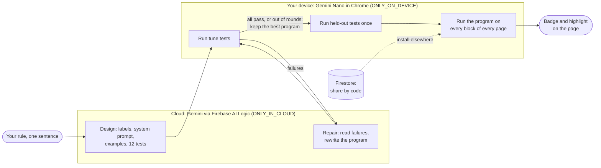

# Cantrip

**Say what to watch for. Gemini in the cloud writes and tests a program for Gemini Nano, which then checks every page you read, free and on your device.**

Job seekers scroll past dozens of posts a day, and some of them hide that there is no pay, or
that you will be the one paying. People in the US reported losing $501 million to job and
employment agency scams in 2024,
[up from $90 million in 2020](https://www.ftc.gov/news-events/news/press-releases/2025/03/new-ftc-data-show-big-jump-reported-losses-fraud-125-billion-2024)
(FTC). The warning signs are in the text. An on-device model could read every post for free
without sending your job search anywhere, but small models are fragile, and nobody writes good
prompts for them.

So you type one sentence: *"Warn me when a job post is really commission-only."*
Gemini in the cloud writes a tiny program for the model on your device, writes tests for it,
runs those tests **on your device**, reads what failed, rewrites the program, and repeats.
When it passes, the program runs on Gemini Nano on every page you read: no cloud call,
no cost, works offline, and the text never leaves your machine.

Built for [#BuildHybridAI](https://firebasehybridaihackathon.devpost.com/) with Firebase AI Logic.
Platform: Web (Chrome), as a web app and a Chrome extension.

## Try it

| Way | What you need | What you see |
|---|---|---|
| **Video** | Nothing | The whole loop on real hardware. Link added on submission day. |
| **Hosted app:** https://sixth-trainer-388221.web.app | Desktop Chrome 148+ with Gemini Nano (see below) | Compile a rule, watch every test run on your device, try it on any text, correct it, share it by code. |
| **Simulated walkthrough:** https://sixth-trainer-388221.web.app/?preview | Any browser | The interface with scripted answers and a banner saying so. No model runs in it. For seeing the flow when your machine has no Gemini Nano. |
| **From source, no keys:** `npm install && npm test` | Node 22 | 50+ tests of the compiler loop, the page splitter and the badges, with fake models. |
| **Chrome extension** | Your own Firebase project (below) | Reads the open tab and badges what your rules flag. Its App Check debug token can't be published, so there is no prebuilt download. |

**Gemini Nano in Chrome:** an up-to-date desktop Chrome (148 or later), about 22 GB
of free disk space, and 16 GB of memory or a GPU with more than 4 GB of VRAM. Chrome downloads
the model once, the first time you press **Download the model** (about 4 GB, it took 28 minutes
on our test laptop). Without the on-device model the site still loads and says what is
missing. It never quietly runs your text in the cloud.

**Gemini Nano 4:** to use Gemini Nano 4, as the contest describes, turn on
**Gemma 4 for Built-in AI** in `chrome://flags` ([contest FAQ](https://firebasehybridaihackathon.devpost.com/details/faqs)).
The real runs below used Chrome 157 with no flags turned on.

## Results from real runs

Every number below came from a real run on a MacBook with an M2 Pro and 16 GB of memory,
Chrome 157 with no flags, Gemini Nano through Firebase AI Logic. Details, misses and all, are
in [`docs/real-runs.md`](docs/real-runs.md).

| Rule | Tests passed on the device, round by round | Unseen tests | Cloud calls | Device runs | Time |
|---|---|---|---|---|---|
| Commission-only jobs | 8/9, then 9/9 | 3/3 | 2 | 21 | 85.1 s |
| Pressure-to-pay emails | 5/8, 7/8, 7/8, then 8/8 | 3/4 | 4 | 36 | 166.9 s |
| Paid-for reviews | 7/8, 7/8, 7/8, then 8/8 | 4/4 | 4 | 36 | 183.7 s |
| Data-selling terms | 9/9 on the first draft | 3/3 | 1 | 12 | 51.1 s |

- All 105 test runs reported `on_device` as their source.
- A device run took about 1.9 seconds (median). Running a compiled program made no network
  request at all, on localhost and on the hosted site.
- Gemini Nano is not deterministic: one borderline email got three different labels on three
  runs, so a score can move by a test between runs.

## How it fits together



The cloud sees your rule and synthetic test texts. It never sees the pages you read. App Check
guards every Gemini call, Remote Config picks the compiler model and round budget, and
anonymous Auth plus Firestore rules let you publish a cantrip by a 7-character code.

## Why this is hybrid, and why it has to be

Most hybrid apps use the cloud as a fallback for when the device can't cope. Cantrip
splits the work by what each side is best at:

| | Cloud (Gemini, `ONLY_IN_CLOUD`) | Device (Gemini Nano, `ONLY_ON_DEVICE`) |
|---|---|---|
| Job | Compiler: designs, tests and repairs programs | Runtime: runs the program on everything you read |
| How often | A few calls, once per rule | On every block of every page, for as long as the rule is on |
| Sees | Your rule and synthetic test texts | Your pages, emails and posts |
| Cost | A few calls | $0 |

The cloud never sees what you read, and the device never has to be smart enough to write
its own instructions. Small models are fragile about prompting; a big model that can watch
the small one fail, on the real hardware, can fix that. Google's own
[Automated Prompt Optimization](https://developer.android.com/blog/posts/how-automated-prompt-optimization-unlocks-quality-gains-for-ml-kit-s-gen-ai-prompt-api)
shows the idea works offline for developers. Cantrip does it live, for anyone, from one sentence.

## How the compiler works

The diagram above, in words. Tests are split per label: two thirds tune the program, one
third is held out and never shown to the repair step.

- **Honest accuracy.** A third of the tests are held out from the repair loop, so the
  "unseen tests" score is earned. Examples that copy a test are dropped for the same reason.
- **Never goes backwards.** Repairs start from the best program so far, and the best one wins.
- **Learns from you.** Mark a verdict wrong and it becomes a test; Cantrip recompiles on your device.
- **Fails closed.** Programs run with `ONLY_ON_DEVICE`, so page text is never silently sent to the cloud.
- **Every verdict says where it ran** (`response.inferenceSource`), and the program Gemini
  wrote is one click away.
- **Share a rule.** Publish a cantrip to Firestore and install it elsewhere by code. On a
  device with a different model, Gemini ports the program and tunes it again there.

## Where Firebase AI Logic is called

- `src/firebase/ai.ts`: every model call. `getAI` + `GoogleAIBackend`, the cloud compiler with
  `InferenceMode.ONLY_IN_CLOUD` and a JSON `responseSchema`, the device runtime with
  `InferenceMode.ONLY_ON_DEVICE`, `onDeviceParams.promptOptions.responseConstraint`, and
  `initializeDeviceModel()` for the one-time download.
- `src/firebase/app.ts`: App Check (required by AI Logic) and Remote Config for the compiler
  model and round budget.
- `src/firebase/share.ts` and `firestore.rules`: sharing through Firestore with anonymous Auth.
- `src/core/`: the compiler loop, the runtime and page segmentation. Pure TypeScript, tested.

## Run it

You need an up-to-date desktop Chrome. Chrome's Prompt API, which Firebase AI Logic uses for
on-device inference, is listed for Chrome 148 on web pages and Chrome 138 in extensions in
[Chrome's Prompt API docs](https://developer.chrome.com/docs/ai/prompt-api). We checked that Chrome 157 needs no flag:
`await LanguageModel.availability()` in DevTools answers `downloadable` on a fresh profile.
For Gemini Nano 4, turn on **Gemma 4 for Built-in AI** in `chrome://flags` (see above).

Chrome downloads Gemini Nano once, the first time you press **Download the model**. For that
it needs about 22 GB of free disk space on the volume that holds your Chrome profile, and
either a GPU with more than 4 GB of VRAM or 16 GB of RAM with 4 CPU cores
([Chrome's requirements](https://developer.chrome.com/docs/ai/prompt-api)). `chrome://on-device-internals` shows the model's
status. On-device prompts have a token limit, which a session reports as `contextWindow`.

1. Create a Firebase project. In the console open **AI Services > AI Logic**, choose the
   **Gemini Developer API**, and finish the guided setup.
2. Register a web app and copy its config into `.env` (start from `.env.example`).
3. App Check: Firebase AI Logic refuses calls without it
   ([enforced for every project since 2 November 2026](https://firebase.google.com/docs/ai-logic/app-check)).
   - Hosted web app: create a score based reCAPTCHA Enterprise key for your domain in the same
     Google Cloud project, register the web app with it under **App Check > Apps** (the console
     listed this provider as **Fraud Defense** when we set it up), and set
     `VITE_RECAPTCHA_ENTERPRISE_KEY` to the site key. Firebase
     [recommends reCAPTCHA Enterprise for new integrations](https://firebase.google.com/docs/app-check/web/recaptcha-provider).
     `VITE_RECAPTCHA_V3_KEY` is still read, for projects already registered with reCAPTCHA v3.
     App Check can refuse calls for a minute or two after registering.
   - Local dev and the extension: create a debug token under
     **App Check > Apps > Manage debug tokens** and set `VITE_APPCHECK_DEBUG_TOKEN`.
   - Build the hosted site with the debug token empty, and never commit it:
     `VITE_APPCHECK_DEBUG_TOKEN= npm run build`, then check that
     `grep -r "$YOUR_TOKEN" dist/web` finds nothing.
4. Turn on **Authentication > Anonymous** and create a **Firestore** database, then deploy
   the rules: `firebase deploy --only firestore:rules`.
5. Optional: in **Remote Config** set `compiler_model` (default `gemini-3.6-flash`) and
   `max_rounds` (default 4).

```bash
npm install
npm test               # compiler, runtime, page splitter, badges and error messages
npm run dev            # web app at http://localhost:5173
npm run build:extension  # then load dist/extension at chrome://extensions (Developer mode)
npm run preview:simulated  # the interface with scripted models, no Firebase needed
```

Deploy the web app with `VITE_APPCHECK_DEBUG_TOKEN= npm run build && firebase deploy --only hosting`.

## The Chrome extension

Open the side panel from the toolbar. Compile a cantrip, switch it on, and press
**Read this page**: each post, card or message on the tab is checked on your device, and
flagged ones get a badge with the deciding words highlighted (CSS Custom Highlight API,
no DOM rewriting). Select any text and choose **Check with Cantrip** from the context menu.

`demo/jobs.html` and `demo/inbox.html` are sample pages with made-up job posts and emails, for
trying **Read this page** without depending on a live site. With `npm run dev` running they
are at `http://localhost:5173/demo/jobs.html` and `http://localhost:5173/demo/inbox.html`.

If two cantrips flag the same block, their badges sit side by side. Cantrip's own badges are
never read back into the model on the next pass.

## What has and hasn't run on real hardware

| Part | State |
|---|---|
| Web app: compile, run, correct, share, install (localhost and hosted) | Run on Gemini Nano in Chrome 157, 14 November. See `docs/real-runs.md`. |
| Extension: page splitting, badges, highlights, clearing on a second read | Run in Chromium with the unpacked extension on the demo pages, 23 November, with scripted verdicts. |
| Extension: side panel with Gemini Nano reading a live tab | Not run yet on Gemini Nano. |
| iPhone app (`ios/`) | Builds for the Simulator. Never run on a phone, so no iPhone result is claimed. |

## Limits

- Gemini Nano runs on desktop Chrome only. Without it, compiling is disabled rather than
  quietly running in the cloud.
- Inputs are clipped to 3,000 characters to stay inside the on-device model's token limit.
- Compiling needs network. Running does not.
- The extension uses an App Check debug token, because reCAPTCHA cannot load inside an
  extension page. That is fine for judging and not for a store release.

## License

Apache 2.0.
